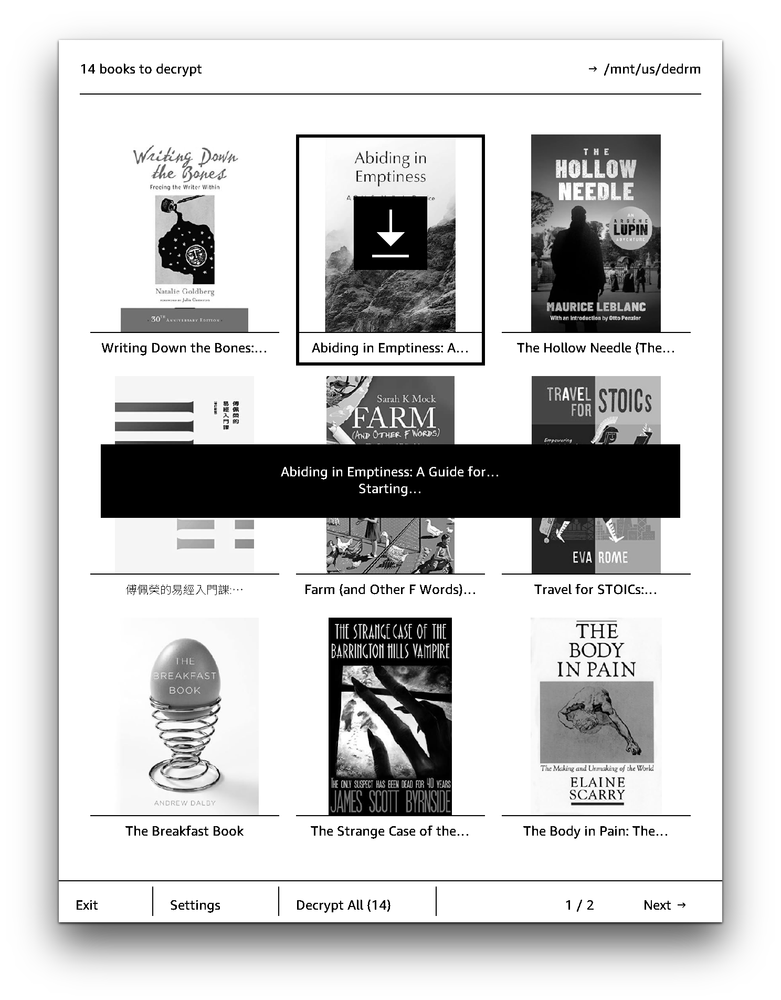
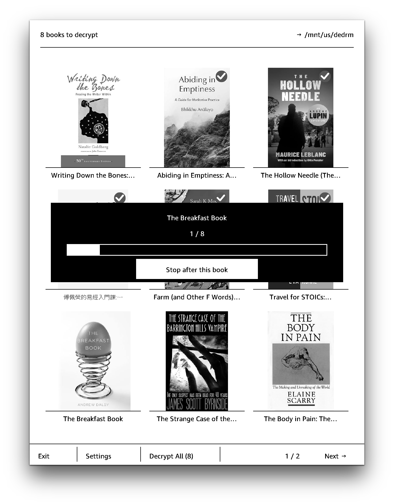

# kfxdedrm-fe 

`kfxdedrm-fe ` is a frontend for [kfxdedrm](https://github.com/Satsuoni/DeDRM_tools) on a jailbroken Kindle as a standalone scriptlet/extension. A KOReader plugin is also added as an afterthought, both now come with capacity to convert KFX to EPUB on device with [bokai](https://github.com/huangziwei/sidle/releases).

You might want to know:

- Both `kfxdedrm-fe` and `kfxdedrm.koplugin` are just a frontend. The core engines for the real jobs are not bundled. You need to either install them yourself first, or fetch them within the apps in their settings's `Update` section. 
- Format conversion is not on by default and you have to turn them on manually in settings, as this is a high risk behavior that one should know what one's doing. 
- Compatibility, the `kfxdedrm-fe` scriptlet is tested on Kindle Oasis 2 (9th Gen; 5.16.2.1.1), Kindle Colorsoft (1st Gen; 5.18.0.2), Kindle Scribe (1st Gen; 5.19.4.0.1). `kfxdedrm.koplugin` is only tested on Kindle Scribe (1st Gen; 5.19.4.0.1). There's no guarantee from me that they will work on untested devices and firmwares. It's not recommended to use it on firmwares lower than 5.16.3.


## Build

```
git clone https://github.com/huangziwei/kfxdedrm-fe && cd kfxdedrm-fe/
rustup target add armv7-unknown-linux-musleabihf armv7-unknown-linux-musleabi
./build.sh          # hard-float, for firmware ≥ 5.16.3
./build.sh armsf    # soft-float, for firmware < 5.16.3, though it's been reported that it's not working
```

Both land in `device/extensions/kfxdedrm-fe/bin/` and `bin/launch.sh` runs whichever one starts, so a release zip carries the two and no one has to know their device's float ABI. Building just the one your Kindle needs is enough for a hand install.

## Install

### KUAL extensions and Scriptlet

Download and unzip the latest `kfxdedrm-fe-v<x.y.z>-kindle.zip` from the [release page](https://github.com/huangziwei/kfxdedrm-fe/releases), then copy:

| from | to | notes |
|:--|:--|:-- |
| `extensions/kfxdedrm-fe/` | `/mnt/us/extensions/kfxdedrm-fe/` | this exact path — the launcher and the settings file are hardcoded to it |
| `documents/KFXDeDRM.sh` | `/mnt/us/documents/KFXDeDRM.sh` | or anywhere you store your scriptlets |

`kfxdedrm` (for deDRM) and `bokai` (for format conversion) are not bundled. If they are not installed already, `kfxdedrm-fe` will prompt you at the first launch, you can tap `install` to fetch the latest version. Or if you skipped them, you can install and update them in the settings page. If it failed, install them manually by going to their release pages, and place them to `/mnt/us/extensions/`.

### KOReader plugin

Download and unzip the latest `kfxdedrm-koplugin-v<x.y.z>.zip` from the [release page](https://github.com/huangziwei/kfxdedrm-fe/releases), then copy `kfxdedrm.koplugin` to `mnt/us/koreader/plugins`. 

`kfxdedrm` (for deDRM) and `bokai` (for format conversion) are not bundled. If they are not installed already, go to `More tools > KFX DeDRM > Tools and updates > Install or update the decryptions tools`. If it failed, install them manually by going to their release pages, and place them to `/mnt/us/extensions/`. 


## Screenshot

<p align="center">
    
    
</p>